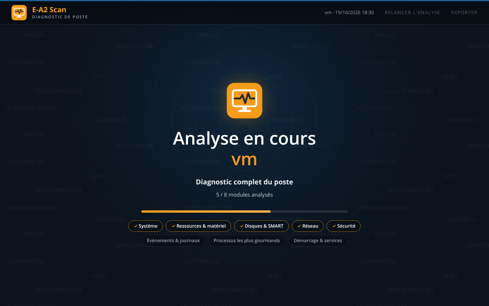
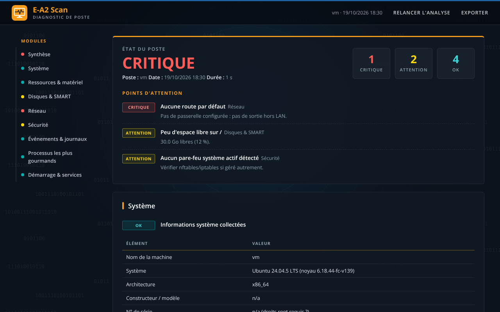
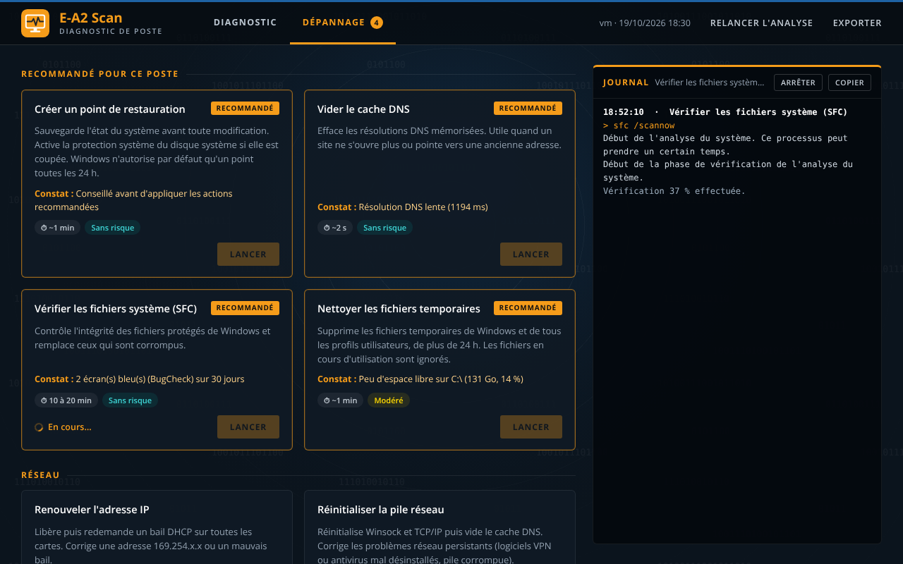
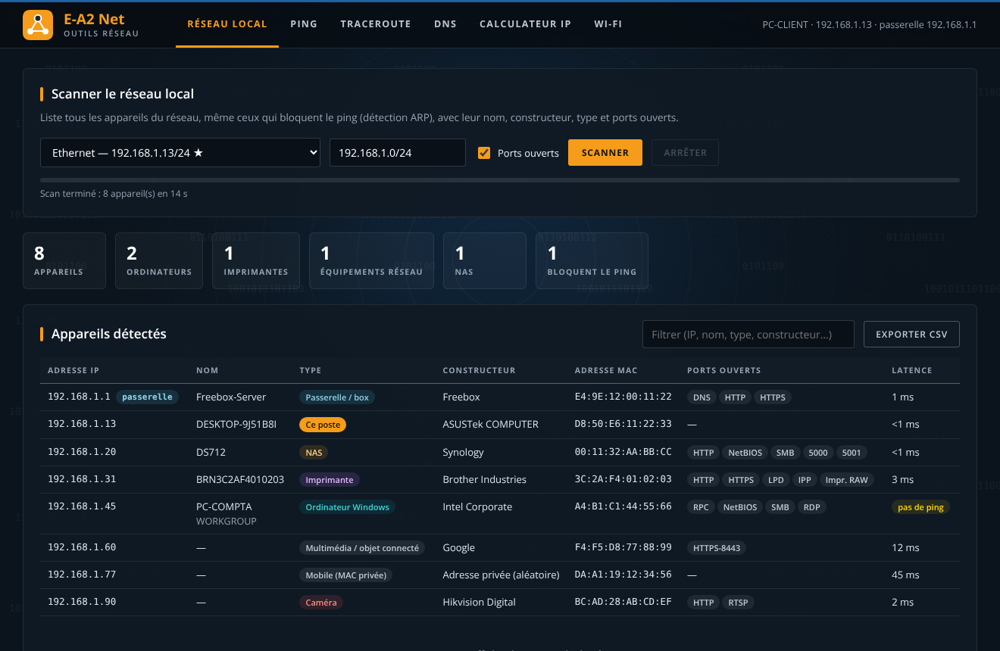
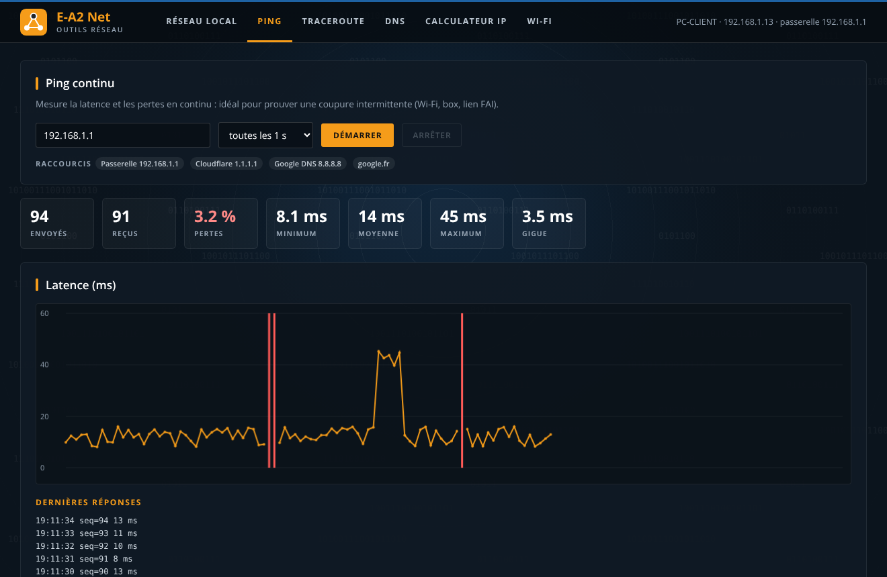
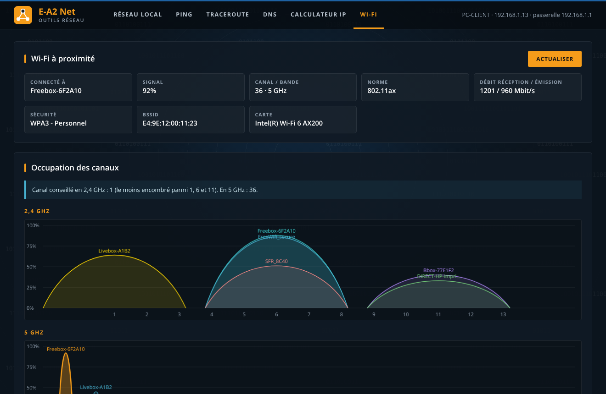
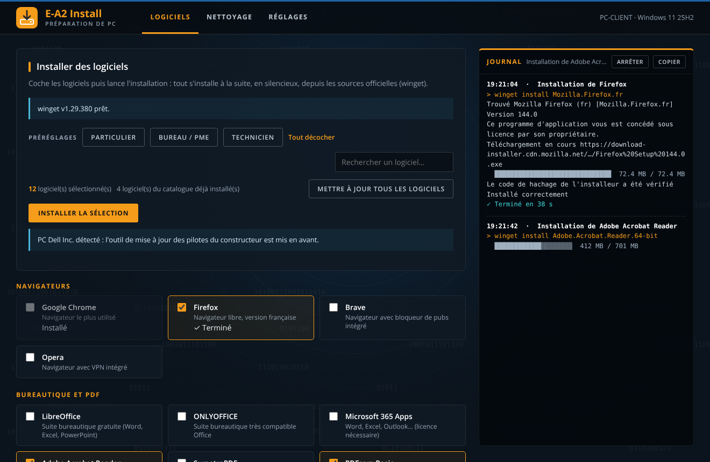
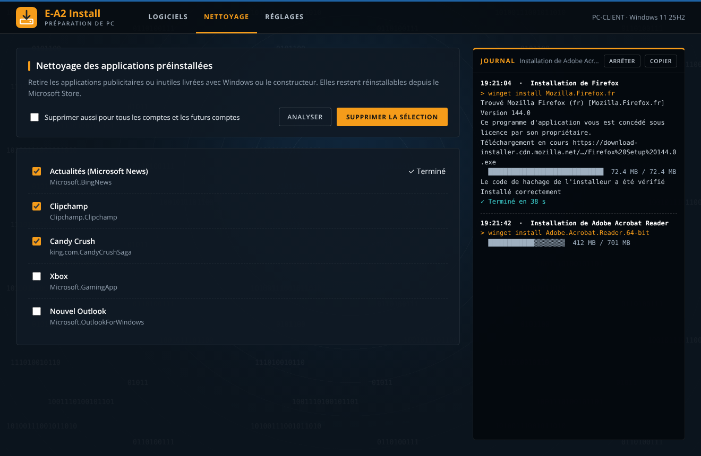
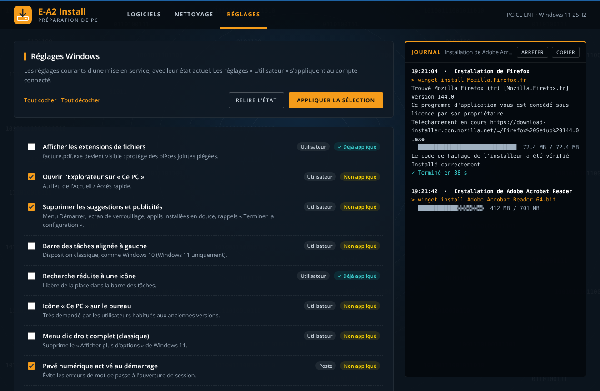
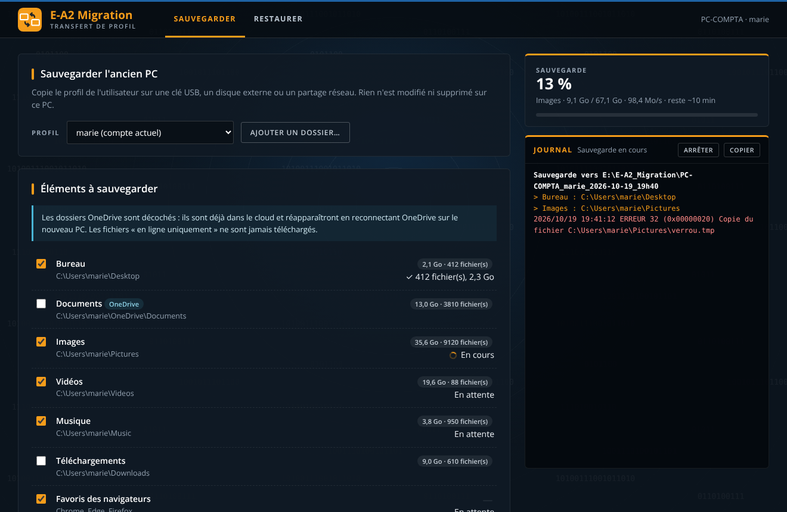

<p align="center">
  &nbsp;&nbsp;
  &nbsp;&nbsp;
  &nbsp;&nbsp;
  
</p>

<h1 align="center">E-A2 Toolkit</h1>
<p align="center"><b>La trousse logicielle du technicien systèmes et réseaux en intervention</b><br>
Quatre outils Windows portables, sans installation, à lancer depuis une clé USB chez le client.</p>

---

| Logiciel | Rôle | Droits admin |
|---|---|:---:|
| **E-A2 Scan** | Diagnostic complet du poste, puis dépannage en un clic | Oui |
| **E-A2 Net** | Scan du réseau local, ping, traceroute, DNS, calculateur IP, Wi-Fi | Non |
| **E-A2 Install** | Préparation de PC : logiciels (winget), nettoyage des applis préinstallées, réglages Windows | Oui |
| **E-A2 Migration** | Transfert de profil d'un ancien PC vers un nouveau | Oui |

Chaque outil est un **.exe autonome** (≈ 14 Mo) : rien à installer sur le poste du client, aucun fichier laissé derrière.
L'interface s'ouvre dans une fenêtre dédiée (moteur Microsoft WebView2, présent sur Windows 10/11 à jour).

## Téléchargement

Les exécutables sont dans le dossier [`dist/`](dist). Copie-les sur ta clé USB, double-clic, c'est tout.

> Les .exe ne sont pas signés : Windows SmartScreen ou certains antivirus peuvent demander une confirmation au premier lancement.

---

## E-A2 Scan - diagnostic et dépannage



**Diagnostic** (10 modules, analyse en parallèle) : système et fin de support de l'OS, ressources (CPU, RAM, températures, santé batterie),
disques et SMART, réseau (APIPA, passerelle, DNS, perte de paquets, portail captif, signal Wi-Fi), sécurité (antivirus, pare-feu,
BitLocker, Secure Boot, SMBv1, ports exposés), mises à jour, journaux d'événements (écrans bleus, arrêts brutaux, erreurs disque),
processus, démarrage, logiciels installés. Résultat : un état global **BON / À SURVEILLER / CRITIQUE** et les points d'attention priorisés.



**Dépannage** : 15 actions en un clic, avec journal en direct et confirmation pour les actions impactantes.
Les actions liées aux problèmes détectés sont marquées *Recommandé*.

| Catégorie | Actions |
|---|---|
| Avant intervention | Point de restauration |
| Réseau | Vider le cache DNS, renouveler l'IP, réinitialiser la pile réseau, resynchroniser l'heure |
| Réparation système | SFC, DISM, analyse du disque système |
| Nettoyage | Fichiers temporaires (tous profils), composants Windows (WinSxS) |
| Windows Update | Rechercher les mises à jour, réparer Windows Update |
| Impression | Débloquer la file d'impression |
| Sécurité | Mise à jour Defender, analyse antivirus rapide |



Export facultatif d'un rapport HTML (avec l'historique des actions effectuées), uniquement sur demande.

## E-A2 Net - outils réseau



- **Réseau local** : découverte ICMP + ARP (détecte aussi les appareils qui bloquent le ping), nom NetBIOS / DNS, constructeur
  (base IEEE OUI intégrée, 40 000 préfixes), type d'appareil deviné (box, PC Windows, NAS, imprimante, caméra, Apple…), ports ouverts,
  ouverture des interfaces web en un clic, export CSV.
- **Ping continu** avec graphe, pertes, min / moyenne / max, gigue.
- **Traceroute** saut par saut avec résolution des noms.
- **DNS** : comparaison des DNS du poste, Cloudflare, Google et Quad9 (A, AAAA, MX, TXT, NS, SOA, CNAME, SRV, PTR).
- **Calculateur IP** et découpage en sous-réseaux.
- **Wi-Fi** : connexion actuelle (y compris Wi-Fi 7 multi-liens), réseaux à proximité, occupation des canaux, canal conseillé.

Fonctionne **sans droits administrateur** (API Windows IcmpSendEcho / SendARP).

<p> </p>

## E-A2 Install - préparation de PC



- **Logiciels** : 57 logiciels courants (identifiants winget vérifiés), préréglages *Particulier*, *Bureau / PME*, *Technicien*,
  installation silencieuse en file d'attente, détection de ceux déjà présents, mise en avant de l'outil de pilotes du constructeur
  (Dell, Lenovo, HP), mise à jour globale, et **réparation / installation de winget** quand il est absent (PC neufs, versions LTSC).
- **Nettoyage** : retrait des applications préinstallées superflues (pour le compte courant ou pour tous les comptes et les futurs comptes).
- **Réglages** : 13 réglages de mise en service avec leur état actuel (extensions de fichiers, pubs et suggestions, pavé numérique,
  démarrage rapide, widgets, points de restauration, heure…) et renommage du poste.

<p> </p>

## E-A2 Migration - transfert de profil



**Sauvegarde** (vers clé USB, disque externe ou partage) : Bureau, Documents, Images, Vidéos, Musique, Téléchargements et dossiers
au choix, favoris des navigateurs (Chrome, Edge, Brave, Firefox, convertis en HTML importable partout), signatures et fichiers .pst
d'Outlook, réseaux Wi-Fi, imprimantes (PrintBrm), lecteurs réseau, fond d'écran, liste des logiciels.

**Restauration** sur le nouveau PC, avec réinstallation automatique des logiciels via `winget import`.

Garde-fous : copie robocopy (reprise, chemins longs), rien n'est modifié sur l'ancien PC, contrôle de l'espace libre, les fichiers
OneDrive « en ligne uniquement » ne sont jamais téléchargés, et la restauration **n'écrase jamais un fichier plus récent**.

> La sauvegarde contient les clés Wi-Fi en clair : effacer le support après la migration.

---

## Compiler

Prérequis : Windows, Python ≥ 3.10 (3.10.1 ou plus récent conseillé).

```powershell
powershell -ExecutionPolicy Bypass -File tools\build.ps1              # les 4 logiciels
powershell -ExecutionPolicy Bypass -File tools\build.ps1 net scan     # au choix
```

Le script installe PyInstaller, pywebview et psutil, puis produit les .exe dans `dist/`.
Avec Python 3.10.0 exactement, il contourne automatiquement un bug connu de cette version (`tools/pyi_fix.py`).

## Structure

```
src/
  ea2ui.py              socle commun : style E-Media, polices, fenêtre WebView2, exécution de commandes en direct, banc de test
  ea2_scan.py           E-A2 Scan
  ea2_net.py            E-A2 Net (+ ea2_net_core.py : ICMP, ARP, NetBIOS, DNS, Wi-Fi ; ea2_oui.py : base des constructeurs)
  ea2_install.py        E-A2 Install
  ea2_migration.py      E-A2 Migration
  ea2_*_tests.py        tests complets de chaque logiciel (mode --fulltest)
icons/                  icônes et logos
tools/                  compilation, lecture des résultats de tests, campagne de tests en VM
dist/                   exécutables compilés
```

## Tests

Chaque logiciel embarque un mode de test complet qui exécute chaque fonctionnalité comme le ferait l'interface, vérifie
l'effet réel dans Windows, capture l'écran et consigne les résultats (JSONL) :

```powershell
"dist\E-A2 Net.exe" --fulltest C:\resultats        # sans risque : lecture seule
python tools\show_results.py C:\resultats FAIL,WARN
```

> ⚠️ Pour **Install, Migration et Scan**, le mode `--fulltest` installe des logiciels, supprime des applications, modifie des réglages,
> restaure des fichiers et lance les actions de dépannage : **à exécuter uniquement dans une VM jetable**.
> `tools\vm\start_vm_tests.ps1` lance automatiquement toute la campagne dans **Windows Sandbox**.

État actuel :

| Logiciel | Tests |
|---|---|
| E-A2 Net | Test complet sur un réseau réel : 68 vérifications, toutes validées |
| E-A2 Scan | Analyse validée sur un poste réel ; actions de dépannage : campagne VM à exécuter |
| E-A2 Install | Lectures validées sur un poste réel (catalogue, détection, applis, réglages) ; installations et modifications : campagne VM à exécuter |
| E-A2 Migration | Sauvegarde + restauration validées à l'identique (SHA-256) sur données de test ; restauration sur un vrai profil : campagne VM à exécuter |

## Crédits

- Police [Open Sans](https://fonts.google.com/specimen/Open+Sans) (SIL Open Font License 1.1)
- Base des constructeurs MAC : paquet [oui-data](https://github.com/silverwind/oui-data) (BSD-2-Clause), données IEEE
- [pywebview](https://pywebview.flowrl.com/), [psutil](https://github.com/giampaolo/psutil), [PyInstaller](https://pyinstaller.org/)

Projet réalisé pour **E-Media Services** et **A2MI**.
